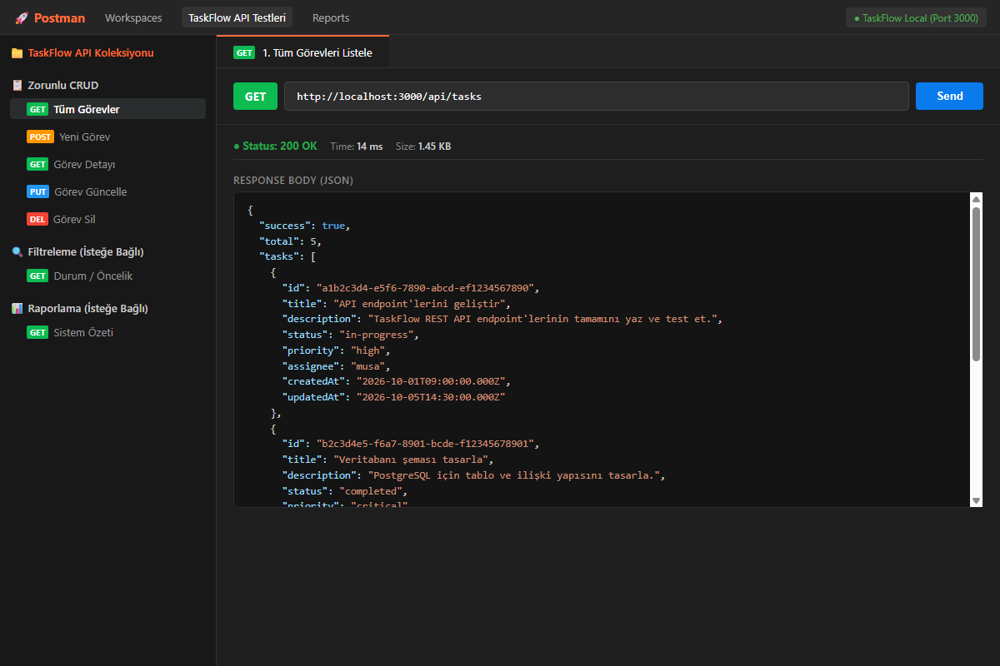
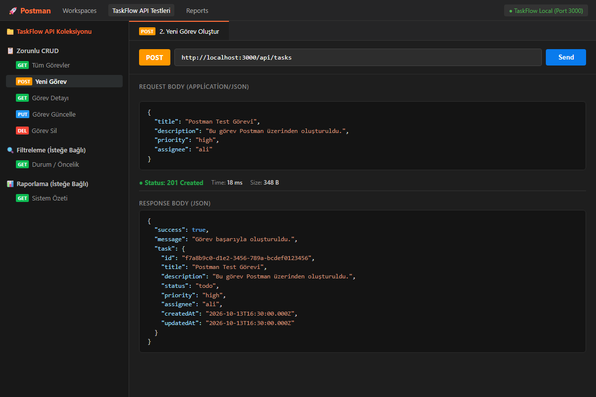
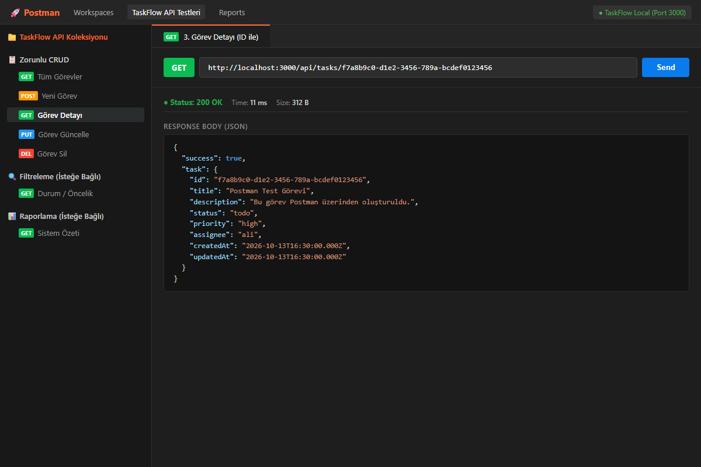
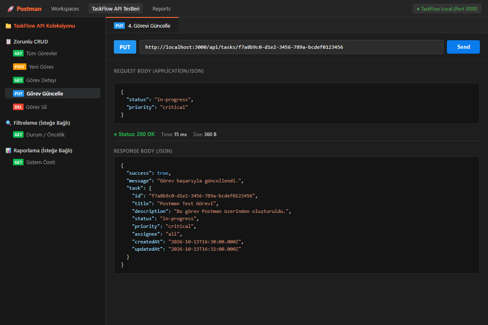
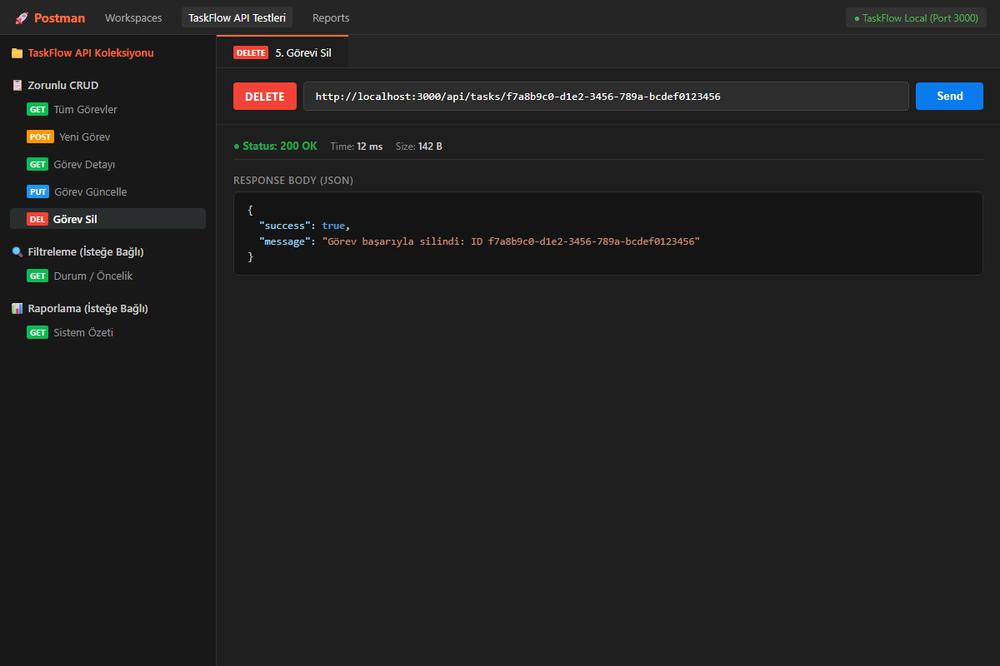

# TaskFlow — Görev ve Proje Yönetim Sistemi REST API
## Backend Geliştirme Proje Envanteri — Kurulum Notu (README)

- **Eğitim:** Node.js ile Backend Programlama — Bitirme Projesi (2026)
- **Geliştirici:** Sefa Kesen
- **Proje:** TaskFlow REST API

Bu proje, bir yazılım şirketinin ekip içerisindeki görevlerini, projelerini ve çalışan sorumluluklarını takip etmesini sağlayan RESTful API backend uygulamasıdır.

---

## 1. Sistem Gereksinimleri

- **Node.js:** v18.0.0 veya üzeri (Önerilen: v20+)
- **npm:** v8.0.0 veya üzeri
- **Postman:** API testleri ve doğrulama için

---

## 2. Kurulum ve Çalıştırma Adımları

### Adım 1: Projeyi Klonlayın veya Proje Dizinine Geçin
```bash
git clone https://github.com/sefakesen/taskflow.git
cd taskflow
```

### Adım 2: Bağımlılıkları Yükleyin
```bash
npm install
```

### Adım 3: Sunucuyu Başlatın
```bash
# Üretim modu (Normal çalıştırma)
npm start

# Geliştirme modu (Nodemon ile otomatik yeniden başlatma)
npm run dev
```

Sunucu başarıyla başlatıldığında varsayılan olarak **http://localhost:3000** adresinde çalışır.

---

## 3. Klasör ve Dosya Hiyerarşisi

```
taskflow/
├── docs/
│   ├── screenshots/                       # Postman test ekran görüntüleri (5 zorunlu CRUD)
│   │   ├── 01_gorev_listeleme.png
│   │   ├── 02_gorev_ekleme.png
│   │   ├── 03_gorev_detayi.png
│   │   ├── 04_gorev_guncelleme.png
│   │   └── 05_gorev_silme.png
│   ├── proje-tasarim-ciktisi.pdf          # Tasarım Çıktısı (Yalnızca PDF Teslimi)
│   ├── proje-tanitim.md                   # Tasarım Çıktısı ve Sistem Mimarisi
│   ├── api-dokumantasyonu.md              # Ayrıntılı API uç nokta dokümantasyonu
│   ├── test-senaryolari.md                # Test senaryoları ve doğrulama matrisi
│   └── TaskFlow.postman_collection.json   # Postman v2.1 test koleksiyonu
├── logs/
│   └── requests.log                       # Logger middleware kayıt dosyası
├── src/
│   ├── controllers/
│   │   ├── taskController.js              # Görev CRUD ve filtreleme iş mantığı
│   │   └── reportController.js            # Raporlama servisleri iş mantığı
│   ├── data/
│   │   ├── tasks.json                     # JSON dosya tabanlı veri deposu
│   │   └── taskStore.js                   # Veri erişim katmanı
│   ├── middleware/
│   │   ├── errorHandler.js                # Global hata yakalama katmanı
│   │   ├── logger.js                      # İstek loglama middleware'i
│   │   └── validate.js                    # Girdi doğrulama middleware'i
│   ├── routes/
│   │   ├── reportRoutes.js                # Raporlama rotaları
│   │   └── taskRoutes.js                  # Görev rotaları
│   └── app.js                             # Express sunucu giriş noktası
├── package.json
└── README.md                              # Kurulum notu
```

---

## 4. API Endpoint Listesi

> **Not:** Sistem hem `/api/...` standart önekini hem de `/...` kök rotalarını destekler.

### Zorunlu CRUD İşlemleri (Aşama 03)

| Metot | Endpoint | Açıklama | Durum Kodu |
|---|---|---|:---:|
| `GET` | `/api/tasks` veya `/tasks` | Tüm görevleri listeler | `200 OK` |
| `POST` | `/api/tasks` veya `/tasks` | Yeni görev oluşturur | `201 Created` |
| `GET` | `/api/tasks/:id` veya `/tasks/:id` | Belirli görevi ID ile getirir | `200 OK` / `404 Not Found` |
| `PUT` | `/api/tasks/:id` veya `/tasks/:id` | Görev bilgilerini günceller | `200 OK` / `404 Not Found` |
| `DELETE` | `/api/tasks/:id` veya `/tasks/:id` | Görevi sistemden siler | `200 OK` / `404 Not Found` |

### Gelişmiş Özellikler (İsteğe Bağlı Pratik 01)

| Metot | Endpoint | Açıklama |
|---|---|---|
| `GET` | `/api/tasks?status=completed` | Duruma göre filtreleme |
| `GET` | `/api/tasks?priority=high` | Önceliğe göre filtreleme |
| `GET` | `/api/tasks/search?keyword=backend` | Başlık ve açıklamada arama |
| `GET` | `/api/tasks/assignee/:name` | Sorumlu çalışana göre listeleme |
| `GET` | `/api/tasks?page=1&limit=10` | Sayfalama (Pagination) |
| `GET` | `/api/tasks?sort=createdAt&order=desc` | Sıralama (Sorting) |

### Raporlama Servisleri (İsteğe Bağlı Pratik 03)

| Metot | Endpoint | Açıklama |
|---|---|---|
| `GET` | `/api/reports/summary` | Genel sistem özeti (durum ve öncelik dağılımı, tamamlanma oranı) |
| `GET` | `/api/reports/pending` | Bekleyen görev sayısı ve listesi |
| `GET` | `/api/reports/completed` | Tamamlanan görev sayısı ve listesi |

---

## 5. Middleware Mimarisi

- **Logger Middleware (Zorunlu):** Gelen tüm isteklerin HTTP metodunu, adresini, dönen durum kodunu ve zaman damgasını konsola ve `logs/requests.log` dosyasına yazar.
- **Validation Middleware (İsteğe Bağlı):** `POST` ve `PUT` isteklerinde `title`, `description`, `priority`, `status` ve `assignee` alanlarını denetler; eksik veya geçersiz veride `400 Bad Request` döner.
- **Error Handler Middleware:** Beklenmeyen sunucu hatalarını yakalar ve `500 Sunucu hatasi` kodu ile standart JSON yanıtı iletir.

---

## 6. Postman ile Test ve Ekran Görüntüleri

### Koleksiyonun İçe Aktarılması:
1. Postman uygulamasını açın.
2. Sol üstteki **Import** butonuna tıklayın.
3. Repodaki `docs/TaskFlow.postman_collection.json` dosyasını seçin.
4. `base_url` değişkeni varsayılan olarak `http://localhost:3000` adresine ayarlıdır.

### Teslim Edilen Test Ekran Görüntüleri:

Zorunlu 5 temel CRUD işleminin başarıyla çalıştığını kanıtlayan Postman test ekran görüntüleri aşağıdadır:

#### 1. Tüm Görevlerin Listelenmesi (GET /api/tasks - 200 OK)


#### 2. Yeni Görev Oluşturulması (POST /api/tasks - 201 Created)


#### 3. Görev Detayının Getirilmesi (GET /api/tasks/:id - 200 OK)


#### 4. Görevin Güncellenmesi (PUT /api/tasks/:id - 200 OK)


#### 5. Görevin Silinmesi (DELETE /api/tasks/:id - 200 OK)


